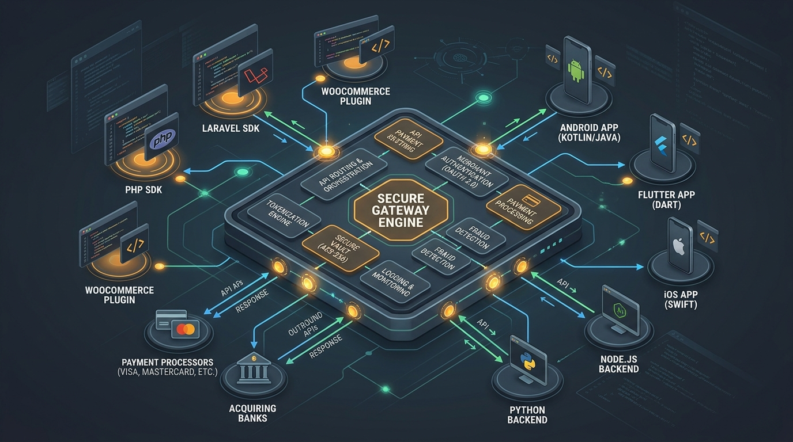
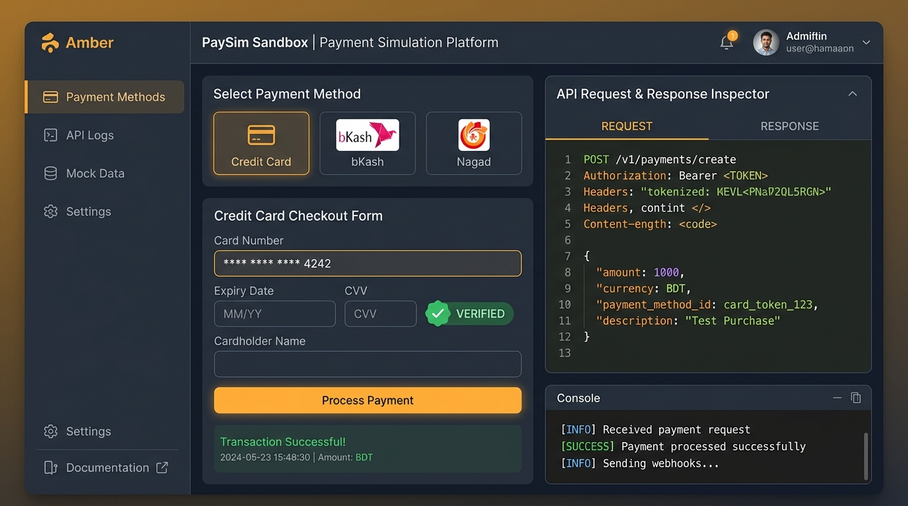

# 🚀 shurjoPay Plugins Hub & Developer Suite V2.0

> **বাংলাদেশ ব্যাংক অনুমোদিত PSO লাইসেন্সপ্রাপ্ত পেমেন্ট গেটওয়ে shurjoPay-এর অফিসিয়াল ডেভেলপার হাব, এসডিকে ডিরেক্টরি, স্যান্ডবক্স সিমুলেটর ও ইন্টিগ্রেশন গাইড।**

<p align="center">
  
</p>

[](https://react.dev/)
[](https://www.typescriptlang.org/)
[](https://vitejs.dev/)
[](https://tailwindcss.com/)
[](https://firebase.google.com/)

---

## 📌 সূচিপত্র (Table of Contents)

1. [ভূমিকা ও পরিচিতি](#-ভূমিকা-ও-পরিচিতি)
2. [প্রধান বৈশিষ্ট্যসমূহ (Key Features)](#-প্রধান-বৈশিষ্ট্যসমূহ-key-features)
3. [টেক স্ট্যাক (Tech Stack)](#-টেক-স্ট্যাক-tech-stack)
4. [লোকাল সেটআপ ও ইনস্টলেশন](#-লোকাল-সেটআপ-ও-ইনস্টলেশন)
5. [পরিবেশ ভেরিয়েবল (.env)](#-পরিবেশ-ভেরিয়েবল-env)
6. [ডিফল্ট টেস্ট ক্রেডেনশিয়াল (Default Sandbox Credentials)](#-ডিফল্ট-টেস্ট-ক্রেডেনশিয়াল)
7. [মডিউল ও আর্কিটেকচার ওভারভিউ](#-মডিউল-ও-আর্কিটেকচার-ওভারভিউ)
8. [সাপোর্ট ও যোগাযোগ](#-সাপোর্ট-ও-যোগাযোগ)

---

## 📖 ভূমিকা ও পরিচিতি

**shurjoPay Plugins Hub V2.0** হলো একটি আধুনিক, পূর্ণাঙ্গ ওয়েব অ্যাপ্লিকেশন যা সফটওয়্যার ডেভেলপার, মার্চেন্ট এবং সিস্টেম ইন্টিগ্রেটরদের জন্য shurjoPay পেমেন্ট গেটওয়ে সংযুক্তিকরণকে দ্রুত ও নির্ভুল করে তোলে। 

এই হাবের মাধ্যমে খুব সহজেই যেকোনো প্ল্যাটফর্মের জন্য অফিসিয়াল প্লাগিন ডাউনলোড, ইন্টারেক্টিভ স্যান্ডবক্সে টেস্ট পেমেন্ট এক্সিকিউশন, রেসপন্স কোড বিশ্লেষণ এবং কাস্টম ক্রেডেনশিয়াল সহ পোস্টম্যান কালেকশন তৈরি করা সম্ভব।

---

## ✨ প্রধান বৈশিষ্ট্যসমূহ (Key Features)

### ১. 📦 প্লাগিন ও অফিসিয়াল এসডিকে ক্যাটালগ (Plugins & SDKs)
- **মাল্টি-প্ল্যাটফর্ম সাপোর্ট**: PHP, Laravel, WooCommerce, OpenCart, Android (Java/Kotlin), Flutter, iOS (Swift), Node.js/Express, Python/Django, Spring Boot (Java), ASP.NET Core (C#), এবং Rust।
- **এক-ক্লিকে ইনস্টলেশন গাইড**: প্রতিটি প্লাগিনের গিটহাব রিপোজিটরি লিংক, ইনস্টলেশন কমান্ড (যেমন `composer require`, `npm install`, `pub add`), কনফিগারেশন স্নিপেট এবং লাইভ সাপোর্ট স্ট্যাটাস।

<p align="center">
  
  <br/>
  <em>চিত্র ১: সেন্ট্রাল পেমেন্ট ইঞ্জিন এবং ১২+ মাল্টি-প্ল্যাটফর্ম এসডিকে কানেক্টিভিটি ইকোসিস্টেম</em>
</p>

### ২. 💳 ইন্টারেক্টিভ স্যান্ডবক্স সিমুলেটর (Interactive Sandbox Simulator)
- **টোকেনাইজেশন টেস্ট**: গেটওয়ের `/api/get_token` এন্ডপয়েন্টে লাইভ কল করে তাৎক্ষণিক বিয়ারার টোকেন (Bearer Token) সংগ্রহ।
- **পেমেন্ট গেটওয়ে চেকআউট**: bKash, Nagad, Rocket, Upay, Visa, MasterCard এবং ইন্টারনেট ব্যাংকিং মেথড সিমুলেশন।
- **অর্ডার ভেরিফিকেশন**: `/api/verification` কলের মাধ্যমে ব্যাংক ট্রানজ্যাকশন আইডি (Bank Trx ID) ও পেমেন্ট স্ট্যাটাস তাৎক্ষণিক যাচাই।
- **রিয়েল-টাইম রেসপন্স ইন্সপেক্টর**: প্রতিটি এপিআই কলের রিকোয়েস্ট পেলোড এবং রেসপন্স হেডার/বডি সহজে পরিদর্শনের সুবিধা।

<p align="center">
  
  <br/>
  <em>চিত্র ২: লাইভ স্যান্ডবক্স চেকআউট সিমুলেটর ও ইনস্ট্যান্ট রেসপন্স ইন্সপেক্টর</em>
</p>

### ৩. 📑 এপিআই ডকুমেন্টেশন ও রেসপন্স কোড গাইড (API Documentation & Error Codes)
- **RESTful এন্ডপয়েন্ট রেফারেন্স**: Authentication, Token Generation, Secret Payment, Verification, Payment Status ইত্যাদি।
- **shurjoPay রেসপন্স কোড ডিকশনারি**: `1000` (Success), `1001` (Failed), `1002` (Pending), `1005` (Invalid Credentials) ইত্যাদি কোডের বিস্তারিত কারণ ও সমাধানের গাইড।

### ৪. 📮 ডাইনামিক পোস্টম্যান কালেকশন এক্সপোর্টার (Dynamic Postman Exporter)
- **প্রি-পপুলেটেড পোস্টম্যান লিংক**: সরাসরি পোস্টম্যান কালেকশন লিঙ্ক যাতে মার্চেন্ট আইডি, ইউজারনেম, প্রিফিক্স ও স্যান্ডবক্স/লাইভ এনভায়রনমেন্ট স্বয়ংক্রিয়ভাবে কোয়েরি প্যারামিটার হিসেবে যুক্ত থাকে।
- **এক-ক্লিকে ইমপোর্ট**: Postman v2.1.0 স্পেসিফিকেশন অনুযায়ী তাৎক্ষণিক JSON ফাইল ডাউনলোড এবং `data:application/json` URI কপি সুবিধা।

### ৫. 🔐 ফায়ারবেস অথেন্টিকেশন ও মার্চেন্ট প্রোফাইল (Firebase Auth)
- **মার্চেন্ট রেজিস্ট্রেশন ও লগইন**: মার্চেন্ট নাম, স্টোর আইডি এবং পাসওয়ার্ড দিয়ে সুরক্ষিত রেজিস্ট্রেশন।
- **ডেমো টেস্ট লগইন**: ১-ক্লিকে স্যান্ডবক্স টেস্ট মার্চেন্ট হিসেবে সাইন ইন সুবিধা।
- **ডাটা সংরক্ষণ**: সফল ট্রানজ্যাকশন হিস্ট্রি এবং স্যান্ডবক্স/লাইভ এপিআই ক্রেডেনশিয়াল ব্রাউজার সেশনে স্বয়ংক্রিয়ভাবে সংরক্ষিত থাকে।

### ৬. ✉️ ডিজিটাল পেমেন্ট রিসিট জেনারেটর (Gmail Receipt Generator)
- কাস্টমারদের অর্ডার সফল হলে প্রফেশনাল ব্র্যান্ডেড পেমেন্ট কনফার্মেশন রসিদ কম্পোজ করার বিশেষ টুল।

---

## 🛠 টেক স্ট্যাক (Tech Stack)

| প্রযুক্তি | সংস্করণ / বিবরণ |
| :--- | :--- |
| **ফ্রেমওয়ার্ক** | [React 19](https://react.dev/) + [Vite 6](https://vitejs.dev/) |
| **টাইপ সেফটি** | [TypeScript 5.8](https://www.typescriptlang.org/) |
| **স্টাইলিং** | [Tailwind CSS v4](https://tailwindcss.com/) |
| **আইকন** | [Lucide React](https://lucide.dev/) |
| **অ্যানিমেশন** | [Motion (Framer Motion)](https://motion.dev/) |
| **অথেন্টিকেশন ও ডাটা** | [Firebase Web SDK v12](https://firebase.google.com/) |
| **সার্ভার ও টুলস** | [Express](https://expressjs.com/), [dotenv](https://www.npmjs.com/package/dotenv), [tsx](https://www.npmjs.com/package/tsx) |

---

## 💻 লোকাল সেটআপ ও ইনস্টলেশন

### পূর্বশর্ত (Prerequisites)
- [Node.js](https://nodejs.org/) (সংস্করণ ১৮ বা তার বেশি) অথবা [Bun](https://bun.sh/)
- npm / yarn / pnpm / bun প্যাকেজ ম্যানেজার

### ধাপসমূহ:

1. **রিপোজিটরি ক্লোন করুন বা ফোল্ডারে প্রবেশ করুন:**
   ```bash
   cd shurjopay-plugins-hub
   ```

2. **ডিপেন্ডেন্সি ইনস্টল করুন:**
   ```bash
   npm install
   # অথবা
   bun install
   ```

3. **এনভায়রনমেন্ট ফাইল প্রস্তুত করুন:**
   ```bash
   cp .env.example .env
   ```

4. **ডেভেলপমেন্ট সার্ভার চালু করুন:**
   ```bash
   npm run dev
   ```
   ব্রাউজারে ভিজিট করুন: [http://localhost:3000](http://localhost:3000)

5. **প্রোডাকশন বিল্ড তৈরি করুন:**
   ```bash
   npm run build
   ```

---

## 🔑 পরিবেশ ভেরিয়েবল (.env)

প্রকল্পের রুট ডিরেক্টরিতে `.env` ফাইলে নিচের ভেরিয়েবলগুলো সংজ্ঞায়িত করতে পারেন:

```env
# অ্যাপের বেস ইউআরএল (ঐচ্ছিক)
APP_URL="http://localhost:3000"

# ফায়ারবেস ওয়েব কনফিগারেশন (ঐচ্ছিক - ক্লায়েন্ট সাইড ফায়ারবেস ফিচার সক্রিয় করার জন্য)
VITE_FIREBASE_API_KEY=""
VITE_FIREBASE_AUTH_DOMAIN=""
VITE_FIREBASE_PROJECT_ID=""
VITE_FIREBASE_STORAGE_BUCKET=""
VITE_FIREBASE_MESSAGING_SENDER_ID=""
VITE_FIREBASE_APP_ID=""
```

*নোট: ফায়ারবেস ক্লাউড কী কনফিগার করা না থাকলেও অন্তর্নির্মিত লোকাল সেশন ম্যানেজারের মাধ্যমে রেজিস্ট্রেশন, লগইন এবং ক্রেডেনশিয়াল সেভ নিরবচ্ছিন্নভাবে কাজ করে।*

---

## 🧪 ডিফল্ট টেস্ট ক্রেডেনশিয়াল (Default Sandbox Credentials)

shurjoPay টেস্ট এনভায়রনমেন্টে পরীক্ষার জন্য নিম্নে বর্ণিত ক্রেডেনশিয়াল ব্যবহার করতে পারেন:

| ফিল্ড | স্যান্ডবক্স ডিফল্ট ভ্যালু |
| :--- | :--- |
| **API Base URL** | `https://sandbox.shurjopayment.com` |
| **API Username** | `sp_sandbox` |
| **API Password** | `pyyk97hu&6u6` |
| **Order Prefix** | `sp` |
| **Store ID / Merchant ID** | `1` |
| **Client IP** | `103.101.1.2` (বা আপনার হোস্টিং আইপি) |

> ⚠️ **সতর্কতা**: লাইভ প্রোডাকশনে ট্রানজ্যাকশন করার সময় shurjoPay মার্চেন্ট পোর্টাল থেকে প্রাপ্ত অফিসিয়াল ক্রেডেনশিয়াল এবং `https://engine.shurjopayment.com` বেস ইউআরএল ব্যবহার করুন।

---

## 📁 মডিউল ও আর্কিটেকচার ওভারভিউ

```
├── public/                 # স্ট্যাটিক অ্যাসেট ও আইকন
├── src/
│   ├── components/         # মূল ইউজার ইন্টারফেস কম্পোনেন্ট
│   │   ├── ApiDocumentation.tsx    # এপিআই গাইড, রেসপন্স কোড ও ডাইনামিক পোস্টম্যান লিংক
│   │   ├── AuthModal.tsx           # ফায়ারবেস রেজিস্ট্রেশন ও লগইন মডাল
│   │   ├── GmailReceiptModal.tsx   # ডিজিটাল পেমেন্ট রিসিট কম্পোজার
│   │   ├── PluginsCatalog.tsx      # ১২+ প্লাগিন ও এসডিকে তালিকা
│   │   ├── PostmanExportModal.tsx  # পোস্টম্যান কালেকশন জেনারেটর ও এক্সপোর্টার
│   │   ├── SandboxSimulator.tsx    # স্যান্ডবক্স পেমেন্ট সিমুলেশন ইঞ্জিন
│   │   └── UserProfileModal.tsx    # মার্চেন্ট প্রোফাইল, ট্রানজ্যাকশন ও সেটিংস
│   ├── services/           # ব্যাকএন্ড ও স্টোরেজ সার্ভিস
│   │   ├── firebaseAuth.ts         # ফায়ারবেস অথেন্টিকেশন ও লোকাল সেশন হ্যান্ডলার
│   │   └── userData.ts             # ট্রানজ্যাকশন হিস্ট্রি ও সেটিংস স্টোরেজ সার্ভিস
│   ├── utils/
│   │   └── postman.ts              # Postman Collection v2.1.0 জেনারেটর
│   ├── data.ts             # প্লাগিন ডাটা, রেসপন্স কোড ও অ্যান্ড্রয়েড কোড স্নিপেট
│   ├── types.ts            # গ্লোবাল টাইপস্ক্রিপ্ট ইন্টারফেস ও এনাম
│   ├── App.tsx             # প্রধান অ্যাপ্লিকেশন ফ্রেমওয়ার্ক ও নেভিগেশন
│   ├── main.tsx            # রিঅ্যাক্ট ডম এন্ট্রি পয়েন্ট
│   └── index.css           # টেইলউইন্ড সিএসএস ভি৪ কনফিগারেশন
├── metadata.json           # অ্যাপলেট মেটাডাটা ও পারমিশন
├── package.json            # প্রজেক্ট ডিপেন্ডেন্সি ও স্ক্রিপ্টস
└── README.md               # প্রজেক্ট ডকুমেন্টেশন
```

---

## 📞 সাপোর্ট ও যোগাযোগ

shurjoPay মার্চেন্ট অনবোর্ডিং, এপিআই সাপোর্ট অথবা টেকনিক্যাল যেকোনো তথ্যের জন্য:

- 🏢 **অফিস**: হক টাওয়ার (১০ম তলা), মহাখালী সি/এ, ঢাকা-১২১২, বাংলাদেশ।
- 🌐 **ওয়েবসাইট**: [https://shurjopay.com.bd](https://shurjopay.com.bd)
- 📮 **পোস্টম্যান ডকুমেন্টেশন**: [shurjoPay Postman Official Docs](https://documenter.getpostman.com/view/6335853/U16dS8ig)
- ✉️ **ইমেইল সাপোর্ট**: support@shurjopay.com.bd

---

<p align="center">
  <b>shurjoPay Developer Hub</b> — সহজ ও নির্ভরযোগ্য পেমেন্ট ইন্টিগ্রেশন।
</p>
